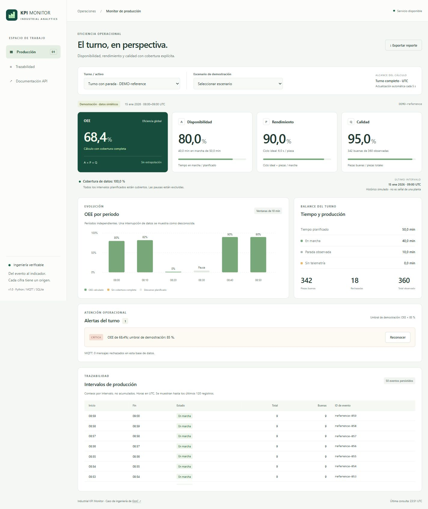
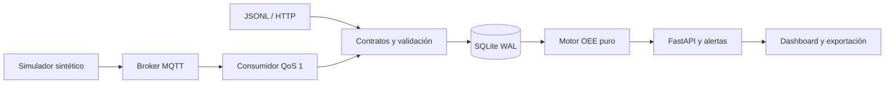

# Industrial KPI Monitor

**OEE auditable, calidad de datos y telemetría MQTT para un caso de producción industrial.**

Python · FastAPI · SQLite · MQTT · Pruebas de integración

Un monitor que distingue una máquina detenida de una señal ausente. Calcula disponibilidad, rendimiento y calidad a partir de intervalos, conserva la trazabilidad de las piezas y muestra cuándo un indicador todavía no se puede calcular.

**English:** A runnable industrial OEE demonstrator with duration-based metrics, explicit telemetry coverage, idempotent MQTT ingestion and a traceable dashboard. Synthetic data; no physical PLC or factory deployment is claimed.



## Verlo funcionando

Con Python 3.11–3.14 y [uv](https://docs.astral.sh/uv/getting-started/installation/):

```bash
git clone https://github.com/GzoC/real_time_kpi_monitor.git
cd real_time_kpi_monitor
uv sync --locked
uv run --no-sync kpi-monitor demo
```

Abre **http://127.0.0.1:8000**. La demo carga un turno sintético e incluye cinco escenarios seleccionables. API interactiva: **http://127.0.0.1:8000/docs**. Detener: `Ctrl+C`. Los datos persisten en `var/monitor.db`; repetir la demo no duplica piezas.

Alternativa con pip, desde un entorno virtual activado:

```bash
python -m pip install --require-hashes -r requirements.txt
python -m pip install --no-deps .
kpi-monitor demo
```

Para comenzar con una base vacía y deshabilitar la carga de escenarios:

```bash
uv run --no-sync kpi-monitor --db var/external.db serve
```

## Un resultado que puedes comprobar

El escenario `reference` contiene 60 minutos de turno, 10 de descanso excluido, 10 de parada, 40 de marcha y un ciclo ideal de 6 segundos. Produce 360 piezas, 342 buenas:

| Indicador | Cálculo | Resultado |
|---|---|---:|
| Disponibilidad | 40 / 50 minutos | 80 % |
| Rendimiento | 6 × 360 / 2400 segundos | 90 % |
| Calidad | 342 / 360 piezas | 95 % |
| OEE | 0,80 × 0,90 × 0,95 | **68,4 %** |

| Escenario | Cobertura | OEE esperado | Qué demuestra |
|---|---:|---:|---|
| Turno con parada | 100 % | 68,4 % | Pérdidas desglosadas y alerta reconocible |
| Operación estable | 100 % | 98 % | Velocidad ideal y 10 piezas rechazadas |
| Pérdida de telemetría | 80 % | Desconocido (`null`) | Un hueco no se transforma en éxito ni en parada |
| Rechazo total | 100 % | 0 % | Una calidad de cero permanece en cero |
| Sin datos | 0 % | Desconocido (`null`) | No se inventa un OEE de 100 % |

Los eventos usan fechas históricas fijas y se identifican como sintéticos. La API se actualiza con nuevos eventos y el dashboard consulta cada cinco segundos; reproducir un histórico acelerado no representa la latencia de una planta.

## Qué aporta el proyecto

- **Criterio de proceso:** tiempos planificados, pausas excluidas, paradas observadas, conteos y ciclo ideal explícitos. Muestreo irregular ponderado por duración.
- **Calidad de datos:** valida zona horaria, conteos enteros, límites temporales y solapamientos. No recorta un rendimiento superior al 100 % para ocultar una configuración incorrecta.
- **Integración:** HTTP, importación JSONL y MQTT comparten el contrato. SQLite confirma transacciones antes del ACK del consumidor; un reenvío idéntico es idempotente.
- **Operación visible:** cobertura, antigüedad, tendencia por períodos, eventos, exportación JSON, alertas persistentes y recuperación tras desconexión de la API.
- **Entrega reproducible:** dependencias bloqueadas, paquete instalable, pruebas con broker TCP real, CI y configuración Docker con procesos reales.

## MQTT: del simulador al dashboard

La integración implementada es **MQTT 3.1.1 / QoS 1**. El simulador publica intervalos; no emula un protocolo propietario ni un PLC físico.

Con Docker y Compose instalados:

```bash
docker compose --profile mqtt up --build -d --wait
docker compose run --rm --no-deps consumer mqtt-replay healthy --delay 0.1
```

Selecciona “Operación estable” en **Turno / activo**. El consumidor y la API comparten el volumen SQLite. El servicio `monitor` arranca la demo y el broker está expuesto solo en `127.0.0.1:1883`. Los nombres `reference` y `healthy` corresponden a datos sintéticos persistidos.

Para usar un broker local existente, abre tres terminales con el mismo directorio y base:

```bash
uv run --no-sync kpi-monitor --db var/mqtt.db serve
uv run --no-sync kpi-monitor --db var/mqtt.db mqtt-listen
uv run --no-sync kpi-monitor mqtt-replay reference --delay 0.1
```

Inicia el consumidor antes de publicar. Espera el mensaje `MQTT subscriptions ready`. Host, puerto, credenciales, CA y TLS se configuran mediante variables de entorno: [guía MQTT](docs/MQTT.md). `.env.example` es una plantilla; la CLI no carga archivos `.env` automáticamente.

## Probar y reproducir

```bash
uv sync --locked --extra dev
uv run --no-sync ruff check src tests scripts
uv run --no-sync ruff format --check src tests scripts
uv run --no-sync pytest --cov=kpi_monitor --cov-report=term-missing
uv build
```

Las pruebas MQTT levantan un broker aMQTT en un puerto efímero de loopback. No necesitan Docker ni un broker externo. La CI verifica Python 3.11 y 3.13, construye el paquete y ejecuta una prueba Compose → MQTT → SQLite → API. El [informe de validación](docs/VALIDATION.md) separa lo ejecutado localmente de lo pendiente en CI.

Exportar un fixture, reimportarlo y comprobar el resultado:

```bash
uv run --no-sync kpi-monitor export reference var/reference-fixture
uv run --no-sync kpi-monitor --db var/replay.db import var/reference-fixture/shift.json var/reference-fixture/events.jsonl
uv run --no-sync kpi-monitor --db var/replay.db report reference
```

`export` no sobrescribe archivos existentes. El lote de eventos se valida antes de insertarse y se confirma en una transacción. El alta del turno es una transacción independiente.

## Arquitectura y decisiones



El dominio no depende de HTTP ni de MQTT. Kafka y Airflow se retiraron de esta versión: una demo local reproducible no los necesita. El contrato de intervalos permite incorporar un gateway industrial más adelante sin reemplazar las fórmulas.

- [Fórmulas, cobertura y decisiones temporales](docs/OEE.md)
- [Contrato de datos y endpoints](docs/DATA_CONTRACT.md)
- [Operación MQTT, recuperación y límites](docs/MQTT.md)
- [Validación y evidencia visual](docs/VALIDATION.md)
- [Guion de demostración](docs/DEMO.md)
- [Migración desde la implementación anterior](docs/MIGRATION.md)

## Alcance real

Es un caso de ingeniería para revisión y aprendizaje, con datos sintéticos reproducibles. No es un SCADA, sistema de seguridad, producto multiusuario ni evidencia de puesta en marcha industrial. No incorpora un modelo de IA: las reglas y fórmulas son explícitas.

La API local no incluye autenticación. Los puertos publicados están limitados a loopback; exponerla a una red requiere autenticar usuarios y equipos, TLS, límites de peticiones, política de retención y revisión operacional. SQLite cubre la demo de una instancia; no se afirma alta disponibilidad ni capacidad de planta. Los reportes calculan el **turno completo**: mientras falte parte de su telemetría el OEE global permanece desconocido, aunque las ventanas completas ya tengan resultado.

Autor: [GzoC](https://github.com/GzoC). Licencia [MIT](LICENSE).
